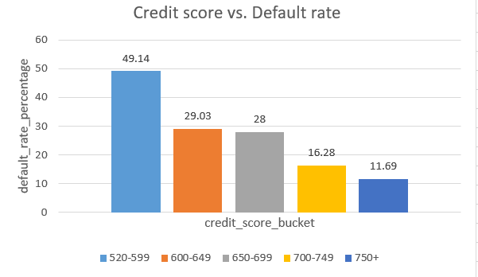
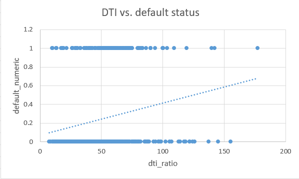
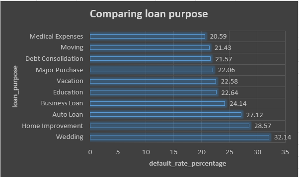

   Loan Default Risk Analysis (SQL-First Approach)

   A professional relational database project designed to evaluate loan default risk, segment high-risk borrower profiles, and inform underwriting strategies using advanced SQL queries.

   Project Structure

   The project is split into two modular, production-ready scripts:
1. setup.sql: Database schema design, table creation ('borrower_profiles', 'loan_applications'), primary/foreign key definitions, and DML setup.
2. analysis.sql: Exploratory Data Analysis (EDA), schema verification ('DESCRIBE'), table joins, Common Table Expressions (CTEs), and conditional aggregations.

   Business Questions
1. What is the overall default rate, and how does it vary by credit score range?
2. Is there a relationship between debt-to-income (DTI) ratio and default? What cutoff would you recommend?
3. Which loan purposes have the highest default rates, and does loan amount differ between defaulted and non-defaulted loans?
4. How do employment status and years employed affect default risk?

   Tech Stack & Skills Demonstrated
   Database Management: MySQL Workbench, Relational Schema Design.
   SQL Techniques: 
  * 'INNER JOIN' for combining multi-table financial data.
  * 'WITH' (CTEs) for modular query architecture.
  * Conditional Aggregation ('SUM(CASE WHEN ... THEN 1 ELSE 0 END)').
  * Data Bucketing/Segmentation using 'CASE WHEN'.
  * 'GROUP BY' and 'ORDER BY' for risk ranking.

   Key Business Insights & Findings

1. Credit Score Impact: Demonstrated a strong inverse correlation between credit scores and default rates. Borrowers in the lowest credit tier (520–599) face nearly a 49% default rate, whereas prime borrowers (750+) drop down to ~11.6%.
2. Debt-to-Income (DTI) Risk: Higher DTI ratios escalate risk, with debt burdens over 50% showing peak default concentration.
3. Employment Stability: Part-time and self-employed borrowers exhibit higher volatility and default rates compared to stable full-time contract workers.
4. Loan Purpose Trends: Evaluated capital allocation and default distribution across various loan purposes (e.g., debt consolidation vs. home improvement).

   How to Run
1. Run 'setup.sql' in MySQL Workbench to initialize the database and tables.
2. Import your dataset rows into the respective tables.
3. Execute 'analysis.sql' to run the complete data exploration and risk segmentation queries.

## Underwriting Recommendations & Policy Guidelines

To mitigate default risk and protect portfolio health, the underwriting team should implement the following data-driven thresholds and policy changes:

1. **Implement a Strict Minimum Credit Score Cutoff**
   * **Finding:** Credit score is the strongest predictor of default, with risk skyrocketing for borrowers in lower tiers compared to prime borrowers[cite: 13].
   * **Recommendation:** Establish a hard minimum credit score cutoff of **600** for unsecured loan approvals.

2. **Enforce a Maximum Debt-to-Income (DTI) Cap**
   * **Finding:** Default risk scales significantly as borrower leverage increases, with debt burdens over 50% showing peak default concentration[cite: 13].
   * **Recommendation:** Cap maximum allowable DTI at **40%**.

3. **Risk-Based Pricing for Volatile Employment Segments**
   * **Finding:** Part-time and self-employed borrowers exhibit higher volatility and default rates[cite: 13].
   * **Recommendation:** Implement dynamic, risk-based pricing for volatile employment tiers to adequately offset elevated statistical default probability.

## Visualizations & Charts

Here are the visual representations generated from our SQL segment analysis using Excel:

1. **Default Rate by Credit Score Range:**
   *(Shows how default risk drops significantly as credit scores improve)*
   

2. **DTI vs. Default Status Scatter Plot:**
   *(Visualizes individual borrower leverage distribution and default clustering)*
   

3. **Default Rate by Loan Purpose:**
   *(Compares default volatility across different loan categories)*
   